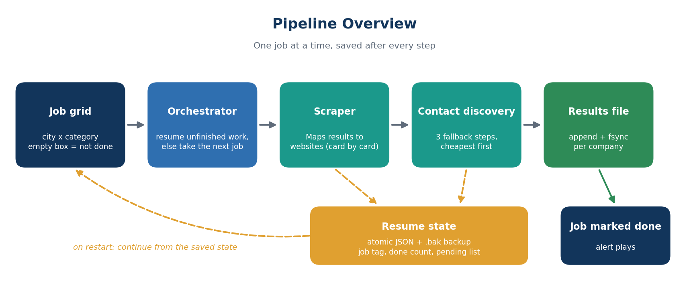
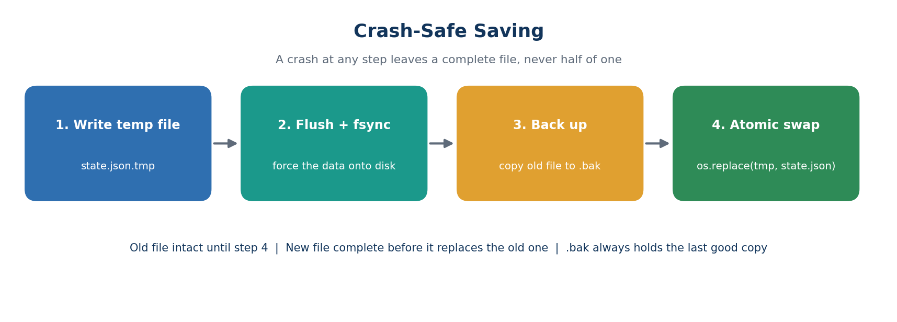
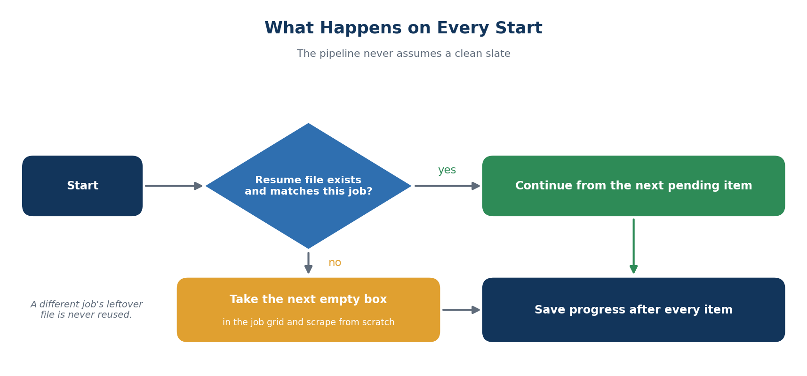
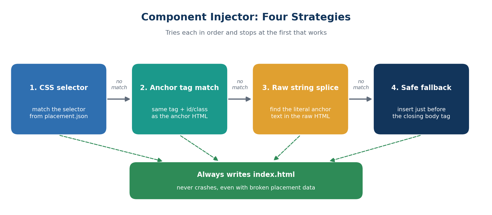

<div align="center">

# 🧰 Resilient Scraping Pipeline

### Architecture Showcase

**A crash-safe, resumable data-collection pipeline: Google Maps scraping, multi-step contact discovery, and a fault-tolerant HTML component injector.**


[Overview](#-pipeline-overview) · [Crash-safe saving](#-crash-safe-saving) · [Component injector](#-component-injector) · [Try it](#-try-it-yourself) · [Docs](docs/ARCHITECTURE.md)

</div>

---

> [!IMPORTANT]
> **This repository is an architecture showcase.** It presents the engineering ideas behind a larger private project, plus two small runnable demos. The full production pipeline is not included.

## 🎯 The problem

Long-running scrapers fail in boring ways: the internet drops, Chrome crashes, a laptop sleeps, a file is locked, a page changes. A script that restarts from zero each time wastes hours and loses data.

This project is built around one rule:

> **A crash at any moment should lose nothing, and running it again should simply continue.**

## 🏛️ Pipeline overview



Each run completes **one job** (one city plus one category). Progress is saved after every single company, and the job grid records which jobs are finished.

## ✨ Engineering highlights

| | Highlight |
|---|---|
| 🔁 | **Resumable state machine.** On start, unfinished work is resumed first, and only then does a new job begin |
| 💾 | **Atomic writes.** State is written to a temp file, flushed, then swapped in with `os.replace`, with a `.bak` of the last good copy |
| 🏷️ | **Job tags.** Resume files record which job they belong to, so a leftover file from another job is never reused |
| 🌐 | **Network awareness.** The pipeline waits for the connection to return instead of recording a false "nothing found" |
| 🧱 | **Card-based extraction.** Each business is read from its own result card, so fields never mix between companies |
| 📜 | **Smart scrolling.** Scrolls the results panel until its height stops growing, instead of using a fixed count |
| 📧 | **Three-step contact discovery** with fallbacks, from cheapest to most expensive |
| ♻️ | **One reusable browser** for the contact step, recreated only if it dies |
| 🔒 | **Locked-file handling.** If a file is open in Excel, it retries instead of crashing |
| 🧪 | **Never-crash injector** with four fallback strategies (see below) |

## 💾 Crash-safe saving



A power cut halfway through a normal `json.dump()` leaves a half-written, unreadable file and loses the whole job. Writing to a temp file and swapping it in means the file on disk is always either the complete old version or the complete new one.

## 🔁 What happens on every start



## 🔍 Contact discovery

Each company goes through three steps, stopping at the first that finds something:

| Step | Source | Cost |
|:--:|---|---|
| 1 | The company's Maps listing | Cheapest, a single request |
| 2 | The **footer** of the company's website | One request plus HTML parsing |
| 3 | The site's **Contact** page | Opens a real browser, clicks the contact link, scans the page |

Results are filtered to the company's own domain (or a short list of common providers) to avoid unrelated addresses.

## 🧩 Component injector

[`injector.py`](injector.py) splices a ready-made HTML component into an existing page. It is designed to **never crash and always produce output**, even when the placement data is imperfect or the page's HTML is messy.



Placement is described in JSON:

```json
{
  "placement": {
    "position": "after",
    "candidates": [
      { "anchor": "<section id=\"services\">", "selector": "#services" },
      { "anchor": "<h2>Our Services</h2>" }
    ]
  }
}
```

`position` can be `before`, `after`, `append` or `prepend`. The injector also accepts an older single-anchor format, reads files in several encodings, and falls back from `lxml` to the standard parser if needed. Implementation notes, including two parser pitfalls found during testing, are in [docs/ARCHITECTURE.md](docs/ARCHITECTURE.md#-component-injector-notes).

## 🧪 Try it yourself

Both demos use only fake data.

### 1. Crash and resume (no dependencies)

```bash
cd examples
python resilient_state_demo.py --reset --crash-after 5   # simulates a hard crash after 5 items
python resilient_state_demo.py                           # resumes at item 6, no duplicates
```

### 2. Inject a component into a page

```bash
pip install -r requirements.txt
cd examples/injector_demo
python ../../injector.py
```

Open the generated `index.html` in a browser. A small instant-estimate widget now sits right after the "Our Services" section of the fictional client page.

## 📤 Example output

The scraper writes plain, easy-to-parse blocks (see [`examples/sample_output.txt`](examples/sample_output.txt)):

```
1).
Organization Name: Example Bakery Co.
Organization Website: https://www.example-bakery.test/
Organization Email: hello@example-bakery.test
Organization Address: 100 Sample Street, Springfield, USA
Organization Phone Number: (555) 010-0101
Google Maps URL: https://www.google.com/maps/place/Example+Bakery+Co
```

The resume file is just as simple ([`examples/sample_scrape_state.json`](examples/sample_scrape_state.json)): a job tag, a count of finished companies, and the list still pending.

*All names, numbers and addresses are fictional.*

## 📂 What's in this repository

```
resilient-scraping-pipeline/
├── README.md
├── injector.py                    # fault-tolerant HTML component injector
├── requirements.txt
├── LICENSE
├── docs/
│   ├── ARCHITECTURE.md            # components and design decisions
│   └── SYSTEM_FLOW.md             # one job, step by step, plus failure scenarios
├── images/                        # diagrams used in this README
└── examples/
    ├── resilient_state_demo.py    # runnable crash-and-resume demo
    ├── sample_output.txt          # example scraper output (fake data)
    ├── sample_scrape_state.json   # example resume file (fake data)
    └── injector_demo/             # sample page, component and placement file
```

## 🧱 Stack

`Python 3.10+` · `Selenium` · `BeautifulSoup + lxml` · `Requests` · `PyAutoGUI`

## ⚠️ Disclaimer

Scraping Google Maps may violate Google's Terms of Service. This project is shared for **educational purposes**. If you collect contact details, follow the privacy and anti-spam laws that apply to you, and get the consent they require before contacting anyone. Provided as is, without warranty.

## 📩 Contact

For collaboration or commercial discussions, reach out through [LinkedIn](https://www.linkedin.com/in/michael-david-osuji) or [ChronoCogna](https://www.chronocogna.com/).

<div align="center">

**Michael-David Osuji**, AI Engineer
[GitHub](https://github.com/Emdysuji)

⭐ If this was useful, consider starring the repo.

</div>
