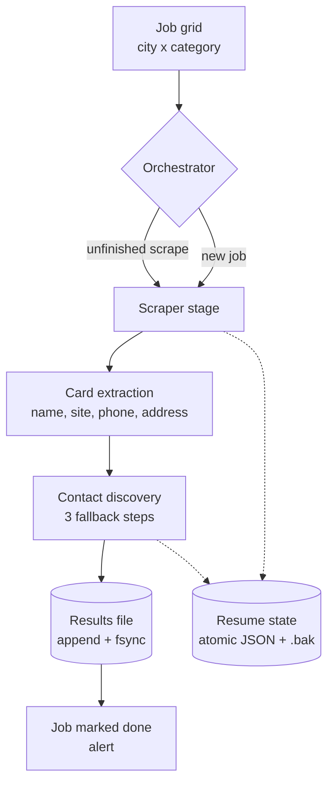

# Architecture

This document describes the components of the pipeline and the reasoning behind the main design decisions.

## Design goals

1. **Never lose finished work.** Results are durable the moment they exist.
2. **Always resumable.** Any crash, reboot or lost connection can be followed by simply running the script again.
3. **Fail loudly, not silently.** When something needs a human, the pipeline stops with a clear message instead of recording wrong data.
4. **Cheap before expensive.** Every lookup tries the fastest method first.

## Components

| Component | Responsibility |
|---|---|
| **Job grid** | A CSV with one row per city and one column per category. An empty box means "not done". The orchestrator writes `done` back safely, retrying if the file is open in a spreadsheet |
| **Orchestrator** | Decides what to do on every start: resume unfinished work first, otherwise take the next empty box |
| **Scraper stage** | Opens the search, scrolls the results panel to the end, then reads each result card individually |
| **Contact discovery** | Three fallback steps from cheapest to most expensive (listing, site footer, Contact page) |
| **Resume state** | A small JSON file holding the job tag, the count of finished companies and the pending list |
| **Results file** | Append-only. Each finished company is written and flushed to disk immediately |

## Key decisions

### Atomic state saves

State is written to `file.tmp`, flushed and `fsync`'d, the current file is copied to `file.bak`, and only then is the temp file swapped in with `os.replace()`. `os.replace` is atomic on Windows, macOS and Linux, so a reader (or a restart after a crash) sees either the complete old file or the complete new one, never a partial write.

### Result first, progress second

For each company the result is appended to the results file **before** the resume state is updated. If a crash lands between the two steps, the company is simply processed once more, and a duplicate is skipped, instead of being silently lost. This is *at-least-once* processing with de-duplication, which is the right trade-off when losing data costs more than repeating a lookup.

### Job tags

The resume file records which job (city and category) it belongs to. If the file belongs to a different job, it is ignored, so a stale file can never leak results from one search into another.

### A damaged state file stops the run

If the state file cannot be parsed, the pipeline stops and points to the `.bak` copy. It does **not** quietly start over, because starting over would repeat hours of work, or overwrite good data.

### Verifying emptiness

A scrape that returns zero companies is treated as a probable captcha or layout change, not as "this city has no businesses". The job is **not** marked done, and an alert tells the operator to look.

### Network awareness

Before concluding that a company has no contact email, the pipeline checks that the internet is actually reachable. If it isn't, it waits and retries. Otherwise a dropped connection would be recorded as "nothing found".

### Card-based extraction

Each result is read from its own card element, so the name, website, phone and address always belong to the same business. Reading separate lists of names and links and pairing them by index breaks as soon as one card is missing a field.

### Scroll to stability

The results panel loads more entries as you scroll. Instead of a fixed number of scrolls, the scraper tracks the panel's height and stops after several consecutive checks with no growth.

## Component injector notes

[`injector.py`](../injector.py) places a prepared component into an existing HTML page. The rule is that it must **always produce an output file**. It tries four strategies and stops at the first that works:

1. **CSS selector** from the placement data
2. **Anchor tag match.** Parse the anchor HTML and look for an element with the same tag, id and classes
3. **Raw string splice.** Find the literal anchor text in the raw HTML
4. **Fallback.** Insert just before `</body>`, or at the end of the file

### Two parser pitfalls found during testing

While building the demo, testing the injector against all four strategies turned up two bugs that only appear when `lxml` is installed. Both come from the same cause: `lxml` wraps every HTML *fragment* in an implicit `<html><body>` structure.

| Bug | Effect | Fix |
|---|---|---|
| The **component** was inserted together with its `<html><body>` wrapper | Stray `<html>`/`<body>` tags pasted into the client page (browsers tolerate it, but it is invalid HTML). A component beginning with `<style>` is even moved into `<head>` by the parser | `component_nodes()` unwraps the fragment and keeps the real content from both `<head>` and `<body>` |
| The **anchor** snippet was parsed as a fragment | `find(True)` always returned `<html>`, so strategy 2 matched the page root and strategies 3 and 4 never ran | Anchors are parsed with `html.parser`, which adds no wrapper |

The lesson: log lines such as "success using strategy 2" prove nothing. The tests that caught these assert **where the component actually landed** in the final DOM.

### Verified behaviours

| Scenario | Result |
|---|---|
| Selector matches | Component placed directly after the target |
| Selector misses, anchor tag matches | Placed relative to the matching element |
| Anchor is plain text | Raw string splice |
| Nothing matches | Inserted before `</body>` |
| `placement.json` is invalid JSON | Warning, then the `</body>` fallback |
| Old single-anchor JSON format | Accepted |
| Component starts with `<style>` | Style and markup both preserved, no stray tags |
