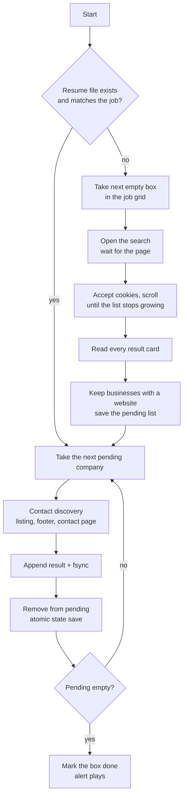

# System Flow

One complete job, step by step, followed by what happens when things go wrong.

## One job, start to finish



1. **Pick the work.** If a resume file for this job exists, carry on. Otherwise take the next empty box in the job grid.
2. **Load the search** and give the page time to settle. Accept the cookie banner if it appears.
3. **Scroll the results panel** until its height stops growing for several checks in a row.
4. **Read every card** and keep only businesses that have a website. Save them as the pending list.
5. **For each pending company:** run contact discovery, append the result to the results file (flushed to disk), remove the company from the pending list, and save the state atomically.
6. **When nothing is pending**, mark the job done in the grid and play an alert.

## When things go wrong

| What happens | What the pipeline does |
|---|---|
| The internet drops mid-job | Waits for the connection, then retries the same company. Nothing is recorded as "no email" |
| Chrome crashes or is closed | The contact-step browser is recreated. If the whole run dies, restart and it resumes from the saved state |
| Power cut or laptop sleeps | The state file is always complete (atomic save). Restart and continue |
| The results file is open in a spreadsheet | Retries until the file can be written, instead of crashing |
| The state file is damaged | Stops with a clear message pointing to the `.bak` copy |
| A leftover state file belongs to another job | Ignored. A fresh scrape starts |
| The scrape returns zero companies | Treated as a captcha or layout change. The job is **not** marked done, and an alert plays |
| A crash lands between writing a result and saving progress | That one company is repeated, and the duplicate is skipped. Nothing is lost |

## Try the recovery behaviour

[`examples/resilient_state_demo.py`](../examples/resilient_state_demo.py) reproduces the crash-and-resume loop with no dependencies:

```bash
cd examples
python resilient_state_demo.py --reset --crash-after 5   # hard crash after 5 items
python resilient_state_demo.py                           # resumes at item 6
```
